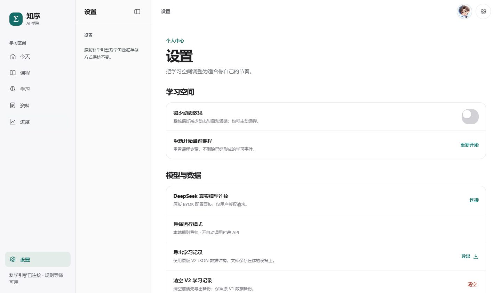
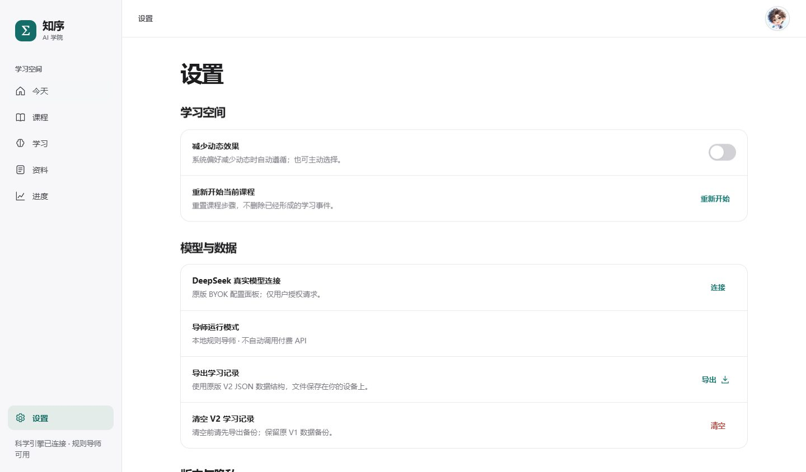

# 知序 AI 学院 Apple V5｜全站 UI/UX 审计与验收报告
**2026-11-03 · 审计基线：44fbf75 · 隔离工作树：feature/zhixu-v5-full-design-audit-20261103**

## 产品、用户与边界
- 产品是**深度理解型理科学习伴侣**，核心路径为“自主判断 → 预测 → 真正计算和实验 → 知序博士追问 → 迁移练习 → 复习证据”，不是小芽生活管理。
- 目标：通过真实学习事件与可复现实验提升学习自主性。默认规则导师与可选用户自带真实模型密钥不得混淆。
- 当前正式评委网址 `https://ndshuge.github.io/zhixu-ai-academy/`，源仓库 `ndshuge/zhixu-ai-academy`，V5 界面 `apple-editions/ai-academy-v5/`。Original、R3、V4 均冻结保存。
- 本轮使用 **Vanilla JS + 原有 Motion 和 Liquid Glass 资源**；没有从无到有重造 UIKit、没有为了 Apple 视觉重写科学引擎。实装方案与参考和 Skill 使用详见 `APPLE_V5_RESEARCH_AND_SKILLS_20261103.md`。

## 覆盖清单：六主页面 / 组件 / 子状态
| 页 / 组件 | 核心任务与交互清单 | 现场审计与验收 | 待补缺口 |
|---|---|---|---|
| 今天 / 开放实验 | 进入独立前测，进入科学实验，Logistic 实时滑块，科学世界卡，四阶段方法，可滚动内容，短/长首屏 | 320/390/768/1440 × Edge 首屏截图，WebKit 滑块 44px 控制区，滚动模糊代码保留 | 语义微文案、完整滑块真实手势轨迹、100%/200% 放大 |
| 课程 | 混沌与生命演化科学世界，侧边目录与不同实验入口 | 路由/导航可达，桌面步骤栏仍显示，手机不横溢 | 无项目登录同步；更丰富课程内容待产品评审 |
| 学习 | 敏感性/非线性/演化三实验 tabs、四阶段、前测、题目、选择、预测表单、运行/证据、导师、第二次实验、迁移、重置 | **P0 同路由重置 bug 复现并修复**；Edge/WebKit 8 组合渲染新页面、V2 事件不删除；44px CTA | BYOK 真实付费请求、学生数据真实实验流程逐项未全走通 |
| 资料 | 待复习、最近作答、待确认误区、确认/拒绝、空态、长任务说明 | 录屏发现 SVG 巨箭头与竖排原因，上一轮 V5 修复已上线；本轮桌面取消无效的二级目录 | 错题不同来源长数据/真实复习后评分仍需完整端到端 |
| 进度 | 科学实验数、作答/迁移次数、知识状态、学习时间线、零记录空态 | 真统计来源、初始 0 正确；桌面去掉纯说明中间栏 | 无真人学习效果 n=0，不能声称已提高成绩 |
| 设置 | 降低动态效果 switch、重新开始、BYOK、导师模式、导出 JSON、清空确认、Original 链接 | 320/390/768/1440 Edge/WebKit 测试所有按钮/link 至少44px；开关 pill 30px、点击盒 44px；删重复标题与齿轮；桌面阅读宽度加大 | 真实 API 授权、键盘辅助/高对比/200% 仍未充分测试 |
| 全局 dock | 5 tabs，玻璃底栏，指示器，滚动边缘；设置作为额外路由 | Tab 语义清楚；设置内不应高亮之前的 Tab，清除旧 lens 及 tint；WebKit/Edge 快速切换基本通过 | iPhone 真机动态地址栏 / 真实 L2 光学仍未完成 |
| 知序博士 | 头像、对话 panel、文字输入、发送、授权、关闭、Esc、重复点击 | 保留已获用户认可的头像；之前修正反复打开时状态；无强制改版 | **WebKit 快速反向中间帧 opacity=0** P1 OPEN，需单一动画状态控制器 |
| 模态/Toast | 危险删除确认、AI 配置遮罩、Toast、失败反馈 | 上一轮用户录屏已有 dock-aware Toast 修复、资料卡复位；本轮不改这些流 | 真机键盘、VoiceOver、关闭前焦点和重连失败等部分路径未验 |
| 其他架构 | V2 LocalStorage、V1 原版备份、hidden scientific iframe、原始 URL 跳转、Original 回退 | 代码范围排除 Original/R3/V4、版本检查已通过 | PFL SHA mismatch（单独阻塞科学封包 verify），Safari 真机未验 |

**清点级别**：已遍历源码主路由和关键组件并进行了真实浏览器测试；表中“未验”不代表不存在功能。不能宣称所有功能深度验证，尤其付费 API/错误路径。

## P0 / P1 / P2 证据矩阵
| ID | 级别 | 实际证据与受影响组件 | Apple 设计依据 | 工程处理 | 验收和状态 |
|---|---|---|---|---|---|
| ZX-01 | **P0** | 线上 Edge/WebKit 学习页同路由点击“重新开始”仍保留新插入 DOM 节点；`goto` 以 unchanged route 早退 | Direct Manipulation、反馈与按钮语义一致 | `v4.js` current learn 调 `render()`、其他 route 正常 goto，数据 V2 不删 | **FIXED** Edge/WebKit × 320/390/768/1440 |
| ZX-02 | **P1** | 320 连接按钮 25px、导出等 37px、原版链接仅20px；中文横向内容挤压 | Control 可点区域、Clarity | V5 CSS 控件最小64×44；原正文缩放 min-width:0，调整间距 | **FIXED** 8/8 测 |
| ZX-03 | **P1** | 桌面 1440 设置/资料/进度有216px“说明型”二级栏，不承载有效导航 | Deference / 内容优先 / Sidebar hierarchy | 仅三页取消二级栏；学习/课程的步骤目录保留 | **FIXED** Edge/WebKit 1440 |
| ZX-04 | **P1** | 320–1440 主页 r 输入滑块原31px、学习“开始前测”43px | Direct Manipulation | `#v5-r-control` 与学习 CTA min-height44px | **FIXED** Edge/WebKit 8组合，复杂拖拽路径仍未全验 |
| ZX-05 | **P1** | iPhone 截图显示设置 switch 原加高后轨道方形 | Restraint，控件应有一致形态 | 44px 点击盒+30px 圆角 pseudo track，实测前后截图 | **FIXED** 二轮截图检查 |
| ZX-06 | **P1** | 设置页当前路由无一个底栏 Tab 对应，但此前的“今天”标签带残留高亮；重复右上设置齿轮 | Navigation clarity | 设置时隐藏 lens，重置 tab tint，隐藏重复 gear；不改变五个全局tab | **FIXED** 浏览器 DOM + screenshot；WebKit 细微过渡需要实机确认 |
| ZX-07 | **P1 OPEN** | WebKit 知序博士关闭→重开中间帧 opacity 会闪到0 | Continuity / Motion interruption | 单一状态 controller 是下一轮计划，不保留曾失败的 WAAPI 重叠补丁 | **OPEN** |
| ZX-08 | **P1 OPEN** | 原版 PFL 适配器 SHA256 与证据不符，`npm run verify` 失败 | 科学可核验性/真实性 | 与 UI 分离调查原始封包与哈希；本轮不修改科学证据 | **FAIL** |
| ZX-09 | **P1 OPEN** | 首页11个文字节点 <12.5px，数学 plot 注释低密度对比 | 中文排版与阅读层级 | 保留原有 V5 polish，本轮不扩展大改以保护图表 | **OPEN** |
| ZX-10 | **P2** | 设置有“个人中心→设置”双层标题和描述，右上角设置页又重复 gear | Clarity/Restraint | `views.js` 用单独“设置”h1，简化 | **FIXED** |
| ZX-11 | **P1 UNVERIFIED** | 真机 iPhone Safari、iOS Safari 浏览器地址栏动态、VoiceOver、200% zoom、L2 光学、深色模式 | Accessibility/Materials/Performance | 建议真实设备矩阵另立质量关 | **UNVERIFIED** |

## 实现清单
- `apple-editions/ai-academy-v5/v4.js`：当前路由 reset 正确重绘；原有 V2 学习事件不删。
- `apple-editions/ai-academy-v5/views.js`：设置页移除额外“个人中心”说明、正文重复标题。
- `apple-editions/ai-academy-v5/index.html`：引入 V5 作用域 `v5-product-design.css`。
- `apple-editions/ai-academy-v5/v5-product-design.css`：设置按钮、开关、学习 CTA/科学滑块、设置 Tab 遮罩状态及桌面动态 sidebar。
- `tests/v5-product-design-audit.test.mjs`：6 个防回归测试。
- `AGENTS.md`：Chat 插件挂载位置与不可虚构实际执行，单页/双端质量门槛，V5 Only。
- `docs/APPLE_V5_RESEARCH_AND_SKILLS_20261103.md`：实际 Apple 官方/开源/插件分工及证据边界。
- `docs/evidence/apple-v5-audit-20261103/`：四张来自 Playwright 的前后真实截图，均无个人学习数据。

## 视觉证据（同视口、真实浏览器）
**手机 390×844 设置页**：左图原小控件、竖排导出及冗余标题；右图最小 hitbox、简洁标题、独立 30px 轨道、去重 gear。

**桌面 1440×844 设置页**：改造前 216px 废空目录栏；改造后正文向主导航直接衔接且阅读宽度合理。

## 验收结论
| 门禁 | 结果与证据 |
|---|---|
| 真实基线及研究 | PASS 24页截图 / 6路由×4视口，Console无异常，无404、无水平溢出 |
| 修复流程 | PASS 6条TDD静态测试，前期 RED→GREEN（同页 reset bug 在真实线上 Edge/WebKit 已先复现） |
| 改造后浏览器操作 | PASS Edge/WebKit × 320/390/768/1440 **8/8**：同页reset清除测试节点、保留V2数据，设置按钮尺寸、桌面栏、CTA/滑块尺寸 |
| 视觉二轮 | PASS 已查看 before/after 390/1440 实际截图，发现开关方形与残留 tab 高亮后改正 |
| 真实控制状态与持久化 | PASS **4/4** Edge/WebKit ×390/1440：Logistic r 3.90→3.72 与实时绘图同步、Reduce Motion toggle 刷新后保留、清空数据确认弹窗可取消；无 JS/404 |
| 项目完整单测 | PASS **119/119**，`npm test` |
| 私密文件名检查 | PASS，仅是文件名检查，**不能视作内容/密钥审计** |
| PFL 完整封包 `npm run verify` | **FAIL — PFL adapter SHA256 mismatch（既有）** |
| WebKit 中途反向透明度 | **OPEN** |
| iPhone Safari 真机 / VoiceOver / Reduce transparency / 200% zoom / L2 | **UNVERIFIED** |
| 完整 AI BYOK 付费测试 / 真人学习效果 | **UNVERIFIED** |
| 整站设计达到 Apple 第一方质量 | **未宣称**，需要真人视觉反馈与真机互动 |

## 后续闭环
1. P1 单一博士弹层动画状态控制器，Edge/WebKit 0/25/50/75/100% 帧与快速反向严格测试。
2. P1 科学引擎 PFL 内容完整性单独溯源并恢复 verify（不可修改证据值伪造通过）。
3. P1 首页图例/字号与低于12.5px的装饰标签，优先能一眼看懂数学对象、交互入口、公式。
4. P1 iPhone 真机 Safari 地址栏伸缩、键盘、动态文本、VoiceOver、Reduced Motion/Transparency、真实帧率/性能。
5. P2 加强课程前测/迁移真实样本测试，完整监测学习成功反馈与操作错误、回退数据，不做虚拟掌握率统计。
6. 远程评委入口仍需在发布后再作线上实证，未经发布的工作树不能冒充线上已更新。
